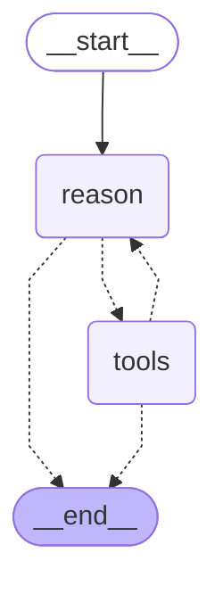
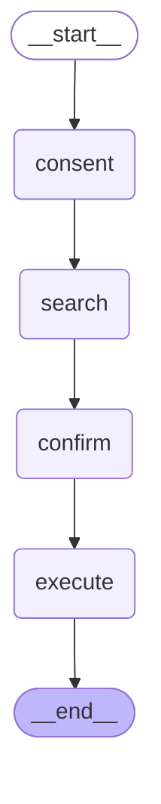
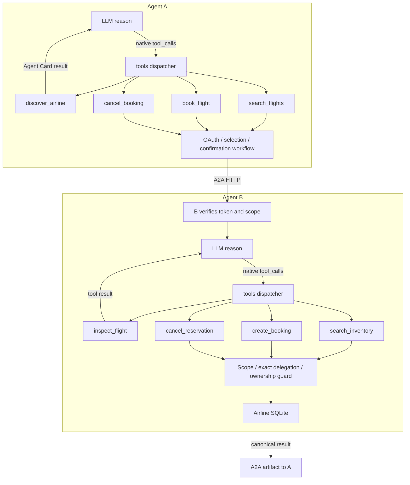
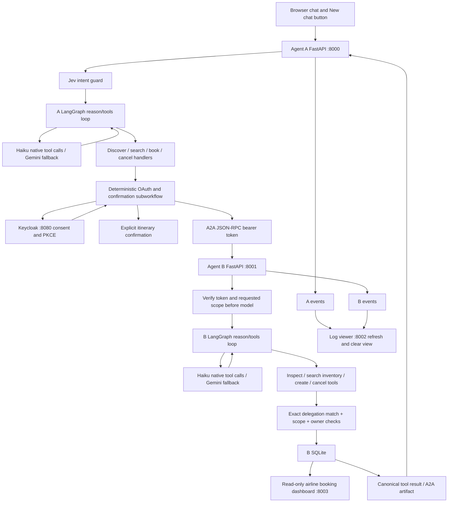

# Architecture

Actual LangGraph Mermaid exports; the conversation graph precedes the execution graph.

## Agent A tool-calling loop

## Agent A authorized execution

## Agent B execution

## Tool connections (dispatcher detail)

The generated graph's single tools node dispatches individual registered functions. Their names are not separate LangGraph nodes. Conditional dotted edges reason -> tools and tools -> reason are executable routing edges. Terminal tool results leave the loop; discovery and inspection results return to the model. A's deterministic subworkflow is called by its tool handlers; it is not an unconnected replacement for the agent.

## Complete system

Models propose tool calls; handlers enforce capabilities and delegation. A workflow pauses for OAuth and purchase approval. B receives verified claims only in private execution context; they are excluded from model prompts. The observer reads structured events, never token stores. Both agent loops allow five model steps and one tool call per step; failures stop without widening permission.

## Direct compiled-edge renders

[Agent A graph](agent-a-graph.svg) and [Agent B graph](agent-b-graph.svg) are generated by `python -m scripts.render_agent_graphs` from the compiled graph edge objects. Both contain reason -> tools and tools -> reason. A regression test asserts these edges for both graphs and executes a controlled reason/tools/reason/tools path with real handler dispatch.
