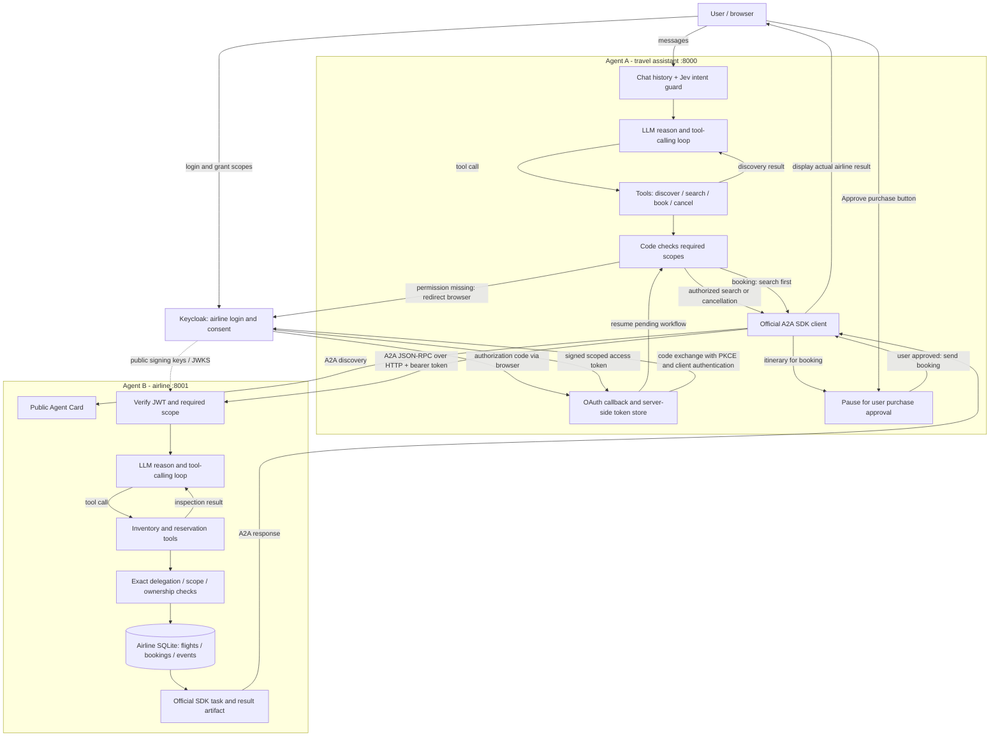

# Simplified architecture: A + B + OAuth

OAuth consent permits an action class; it does not itself create a ticket. The user approves the specific itinerary/price in A; B then independently authorizes and commits the booking. A's model cannot approve a purchase. This second approval is a deliberate demo safeguard, not an OAuth or A2A requirement.

A uses its stored token on A2A calls. B validates it against Keycloak's keys and expected issuer/audience/client, then checks the operation scope. An insufficient grant pauses in A for fresh OAuth consent before the operation is sent. B owns all airline writes and confirmed/cancelled outcomes. Search-only never enters the purchase approval step. Cancellation needs flights:cancel and verified booking ownership, including for references from previous chats.

Both loops use Haiku with Gemini fallback. Jev classifies A's intent. Credentials are kept out of model prompts. Task dispatch and envelopes use SDK 0.3.26 / protocol 0.3.0. A and B are independent processes; observers on ports 8002/8003 are read-only and omitted from this simplified operational diagram.
